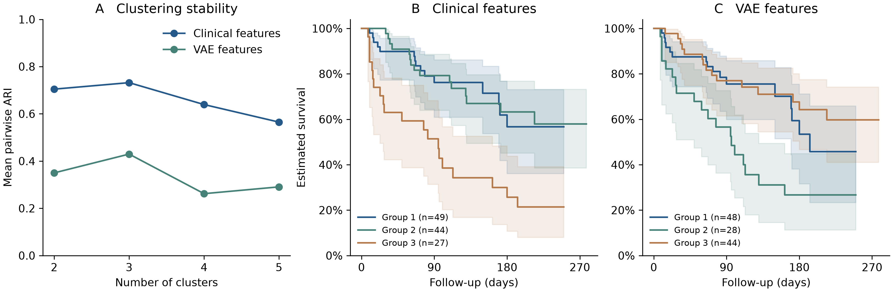

# Heart Failure Phenotyping and Survival Analysis

An exploratory comparison of K-means on clinical measurements versus K-means on a variational autoencoder (VAE) representation. The primary analysis uses 299 patients with heart failure from the open [UCI Heart Failure Clinical Records dataset](https://archive.ics.uci.edu/dataset/519/heart+failure+clinical+records). Its outcome is death during follow-up.



**A** Mean pairwise adjusted Rand index (ARI) over five seeded fits. **B–C** Kaplan–Meier survival curves on 120 held-out patients, with pointwise 95% confidence intervals. Group numbers are local to each method. Numbers at risk by follow-up window are in the [results](uci-results.json).

## Findings

- **The clinical-feature baseline was more stable.** Mean held-out ARI at three clusters was 0.732 for clinical-feature K-means and 0.430 for VAE + K-means. The baseline was more stable across every tested cluster count (two to five).
- **Survival patterns differed across exploratory groups.** In the baseline, the group with the lowest estimated survival had 20 deaths among 27 held-out patients. Its unadjusted hazard ratio versus Group 1 was 3.03 (95% CI 1.55–5.92). The VAE comparison for Group 2 versus Group 1 yielded 2.37 (95% CI 1.22–4.62). The estimates compare different cluster assignments and are not a head-to-head hazard ratio comparison.
- **The younger-women subgroup was small.** The full cohort contains 36 women under 55, including 11 recorded deaths. This is a feasibility count based on age at enrolment, with no subgroup clustering or inference about age of disease onset.

## Method

A fixed split assigns 179 patients to training and 120 to evaluation. Log transforms and training-only scaling are applied to continuous variables. Both methods use the same clinical inputs. Sex is reserved for the subgroup count. Follow-up time and mortality are kept outside preprocessing, representation learning and clustering. Both methods use the same prespecified cluster count of three and the first seed for downstream comparisons. Unadjusted Cox models are fit on held-out assignments and proportional-hazards diagnostic p-values are recorded in the results JSON.

The study uses a small retrospective cohort from Pakistan. Survival analyses are exploratory, model and cluster stability depend on the representation and resampling scheme, and the reported intervals do not capture all clustering uncertainty. The analysis has no independent external cohort and does not establish clinically validated phenotypes.

## Reproduce

```sh
python -m pip install -r requirements.txt
curl -L "https://archive.ics.uci.edu/static/public/519/heart+failure+clinical+records.zip" -o uci-hf.zip
python analyze_uci.py uci-hf.zip
python plot_uci.py
```

The figures are available as PNG and PDF. The panel and trend-plot conventions are based on [figures4papers](https://github.com/ChenLiu-1996/figures4papers) (commit `daa2833f03878454cb9b6ad3f9ecb68acad36ade`).

The earlier synthetic readmission benchmark remains reproducible with `python analyze.py` and `python plot.py`. Its [figure](figures/synthetic-benchmark.png) is separate from the UCI results.

Dataset reference: [Chicco and Jurman (2020)](https://doi.org/10.1186/s12911-020-1023-5).
