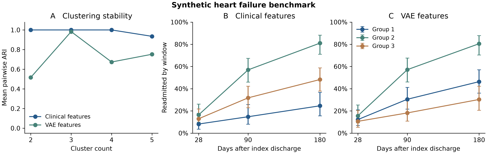

# Heart Failure Phenotyping and Readmission Risk

**Status: synthetic benchmark complete. Zigong analysis pending authorised data access.** No clinical findings are reported in this repository.



The analysis compares K-means on admission variables with K-means on a variational autoencoder (VAE) representation. The demo uses 750 simulated patients with programmed differences in clinical measurements and readmission. It checks whether the pipeline can recover reproducible groups before processing clinical records.

## Run

```sh
python -m pip install -r requirements.txt
python analyze.py
python plot.py
```

A fixed 70/30 patient split keeps the outcome comparison separate. Median imputation and scaling use the training patients only. Readmission fields are excluded from fitting. Stability is the mean pairwise adjusted Rand index across three seeded fits, scored on the same held-out patients for cluster counts two to five. Outcome plots use three prespecified clusters, independent for each method, with complete-window denominators and Wilson 95% intervals. Group numbers are local to each method. The synthetic data are deliberately separable, so results do not establish clinical utility.

## Clinical run pending

[Zigong v1.3](https://physionet.org/content/heart-failure-zigong/1.3/) requires a PhysioNet account and acceptance of its data use agreement. Store the authorised data outside the repository. A normalized input requires one index stay per patient and these columns:

- `patient_id`, `age` (years), `sex` (mapping documented locally)
- `systolic_bp`, `pulse`, `bmi`, `nyha` (admission measurements only)
- `readmit_28`, `readmit_90`, `readmit_180` (0/1 by each window, blank when unknown)

The raw-data mapping and outcome definitions need to be checked against the release dictionary before running. In particular, a missing follow-up or death before a window cannot silently be treated as zero. If the released data give reliable event and censoring times, extend the fixed-window analysis to time-to-event models accounting for death as a competing event. The under-55 subgroup is a feasibility count based on age at admission.

```sh
python analyze.py --input PATH_TO_PRIVATE_NORMALIZED_CSV --output PATH_TO_PRIVATE_RESULTS_JSON
```

Do not commit clinical records or clinical outputs. The bundled plot script renders synthetic outputs only.

Figures follow the panel and trend-plot conventions in [figures4papers](https://github.com/ChenLiu-1996/figures4papers) at commit `daa2833f03878454cb9b6ad3f9ecb68acad36ade`. Figure code is written for this project.
